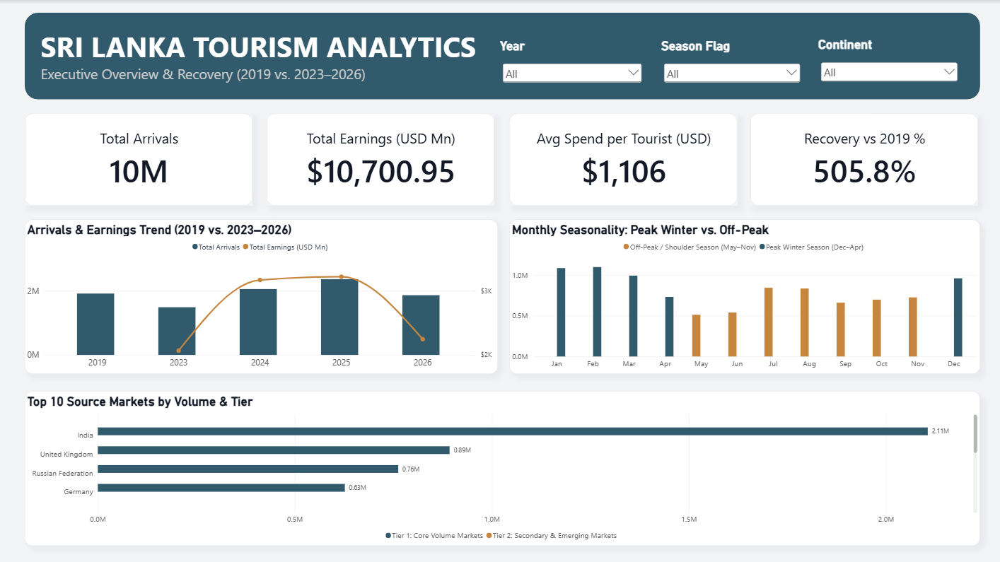
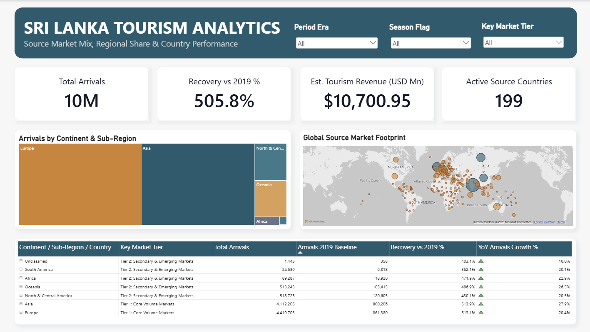

# Sri Lanka Tourism Analytics & Recovery Dashboard (Power BI)

An interactive two-page Business Intelligence dashboard analyzing Sri Lanka's post-crisis tourism recovery, source market mix, and foreign exchange earnings (**2019 Pre-Crisis Baseline vs. 2023–2026**), built using **Central Bank of Sri Lanka (CBSL)** statistical datasets.

---

## Dashboard Previews

### Page 1: Executive Overview & Recovery (2019 vs. 2023–2026)

### Page 2: Market & Regional Deep-Dive

---

## Key Analytical Highlights
- **Recovery Benchmarking:** Tracks cumulative tourist arrivals (`10M+`), foreign exchange earnings (`$10.7B+`), and percentage recovery against the **2019 pre-crisis baseline** across post-recovery years.
- **Seasonality & Era Slicing:** Dynamic cross-filtering across **Period Era**, **Season Flag** (Peak vs. Off-Peak), **Continent**, and **Key Market Tier**.
- **Source Market Segmentation:** Categorizes 199 active source markets into core volume drivers (`Tier 1`) and emerging markets (`Tier 2`), featuring an interactive **Continent → Sub-Region → Country** drill-down matrix with conditional YoY growth indicators.

---

## Data Modeling & Technical Architecture

### 1. Star Schema Design
Structured in Power BI Desktop using a clean star schema to prevent bidirectional filtering ambiguity:
- **`Fact_Arrivals`:** Monthly tourist arrivals granular to source country and date.
- **`Fact_Earnings`:** Monthly tourism foreign exchange earnings (USD Mn).
- **`Dim_Country`:** Geographic hierarchy (`Continent` → `Sub_Region` → `Country`) and market tier classification (`Key_Market_Tier`).
- **`Dim_Date`:** Custom calendar table supporting `Year`, `Month`, `Period Era`, and `Season Flag` slicing.

### 2. Power Query (M) ETL Pipeline
- Standardized country naming conventions across multi-year CBSL releases (2019, 2023–2026) to eliminate unmapped geographic records.
- Unpivoted wide monthly statistical tables into normalized fact tables and enforced strict data types.

### 3. Key DAX Measures
- **`Recovery vs 2019 %`:** Compares selected period arrivals directly against the 2019 baseline using `CALCULATE` and `REMOVEFILTERS` / `ALL` context modifiers.
- **`YoY Arrivals Growth %`:** Evaluates year-over-year percentage momentum using `DIVIDE([Total Arrivals] - [PY Arrivals], [PY Arrivals], BLANK())`.
- **`Est. Tourism Revenue (USD Mn)`:** Volume-weighted revenue allocation measure enabling dynamic country- and region-level revenue estimation when slicing national-level earnings figures.

---

## Repository Contents
- `report/Sri_Lankan_tourism_analytics.pbix` — Complete Power BI Desktop report file (data model, DAX measures, and visuals).
- `report/Sri_Lanka_Tourism_Analytics.pdf` — Static multi-page export of both dashboard views.
- `images/` — High-resolution dashboard screenshots.

---

## How to Run Locally
1. Download `report/Sri_Lankan_tourism_analytics.pbix`.
2. Open it in **Microsoft Power BI Desktop**.
3. Use the top header slicers or click any continent/country in the Treemap, Map, or Matrix to cross-filter visuals.
